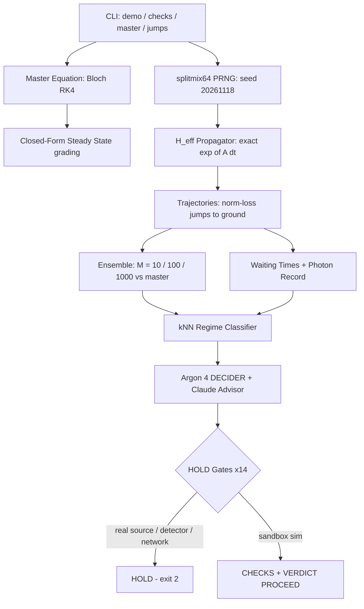
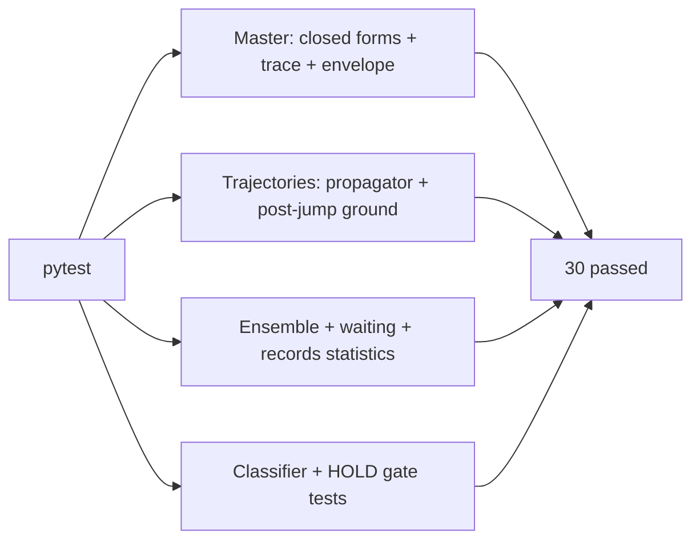
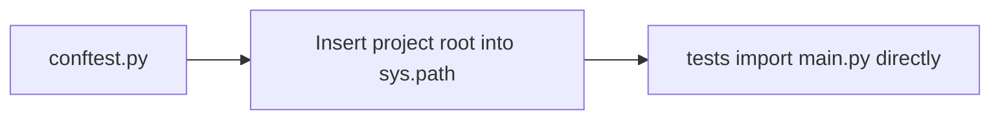
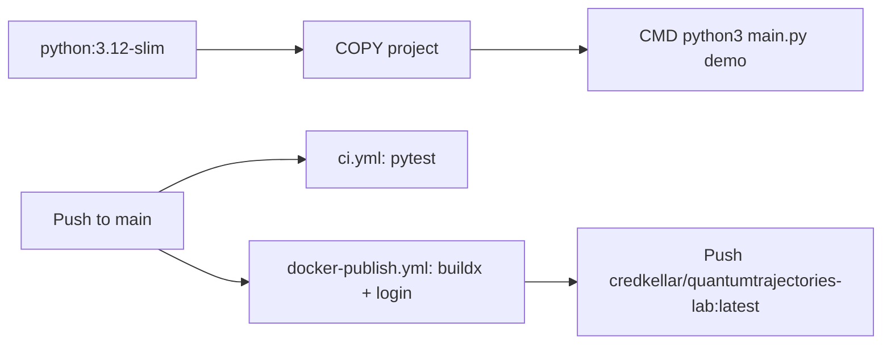

# QuantumTrajectories-Lab 🎲⚛️

**Quantum-Jump Trajectories Lab — Monte-Carlo Wavefunctions vs the Lindblad Master Equation** — by Darion Kellar

QuantumTrajectories-Lab is an **educational open-quantum-systems lab** in ONE pure-Python file. It simulates **one driven two-level atom** (γ = 1 sets the clock; drive Ω and detuning Δ are labelled teaching numbers) the two ways textbooks insist must agree — and then checks that they do:

- **The master equation** — the optical Bloch equations integrated with a written-out RK4: the smooth ensemble curve, with a closed-form steady state to grade against. 🌊
- **Quantum-jump trajectories** — Monte-Carlo wavefunction runs: exact no-jump evolution under the non-Hermitian H_eff, interrupted by emissions that reset the atom to |g⟩. Each run is one jagged simulated record; a thousand of them braid onto the master curve. 🎲

The lab measures the things that are usually just asserted: the ensemble deviation shrinking across M = 10 / 100 / 1000 with its **fitted exponent printed**, the waiting-time mean graded against 1/(γ·ρee_ss) at the data's own standard error, the short-wait suppression that antibunching forces, and the Rabi envelope e^(−3γt/4) read off the integrated Bloch equations.

Honest scope, stated up front: **a trajectory here is a simulated record, not a measured one.** No atom was driven, no photon was detected, no source emitted anything. Detection in the model is ideal (efficiency 1, no dark counts, no dead time) and labelled as such wherever the record appears. Every real source / detector / network / publication use sits behind a permanent HOLD gate (14 total). 🔒

[](https://github.com/kimanicollier44-cmyk/QuantumTrajectories-Lab/actions/workflows/ci.yml)
[](https://github.com/kimanicollier44-cmyk/QuantumTrajectories-Lab/actions/workflows/docker-publish.yml)

> ℹ️ These are the **live** workflow badges for this repo. They activate as soon as the `ci.yml` and `docker-publish.yml` files from the paste pack are pasted into `.github/workflows/` — until then they have nothing to report yet.

## 🧰 Tech Stack Badges & Full Architecture Tech Stack

### 💻 Core Programming Languages & Core Systems


- 🐍 Python 3.12, pure standard library (`math`, `cmath`, `hashlib`, `json`, `sys`) — zero dependencies, zero network, deterministic (double-run byte-identical)
- 🌊 Master-equation core: the optical Bloch equations on (ρee, Re ρeg, Im ρeg, ρgg) with a written-out RK4 — trace preserved to <1e-12 as a conserved linear invariant, steady state graded against ρee_ss = (Ω²/4)/(Δ² + γ²/4 + Ω²/2) to ~1e-15, pure decay and coherence decay graded against e^(−γt) and e^(−γt/2) exactly
- 🎲 Trajectory core: the exact 2×2 propagator exp(A·dt) for A = −i·H_eff in closed form (Sylvester formula), jump probability = the norm loss 1 − ||ψ′||², jump reset to |g⟩ exactly — the only approximation is at most one jump per step, an O((γ·ρee·dt)²) error at dt = 0.02
- 🔢 Seeded randomness from scratch: an in-file splitmix64 PRNG (seed 20261118) — exact integer arithmetic, so a stochastic lab still produces byte-identical output on every machine
- 🧠 TinyML kNN regime classifier (from scratch, stdlib, distance-weighted): emissive-steady / rabi-transient / shelved-dark / weak-drive from (ρee_ss, jump rate, |ρeg_ss|), labels from the lab's own policy
- 🪑 Council seats: Gemini Argon 4 DECIDER (names-only, tighten-only) + Muse advisor (never overrides HOLD) + Google Flow plan-only (rendered = False, live = 0)

### ⛓️ Web3 & Infrastructure

- 🚫 **Not applicable — honestly.** No blockchain, no Web3, no tokens: the "infrastructure" in this lab is one offline file holding a density matrix, a propagator, and a seeded photon record. Quantum-network deployment is a permanent HOLD gate, not a feature. No fake badges here.

### ⚙️ Platform Support & Hardware Architecture


- 🖥️ Pure Python — runs anywhere Python 3.12+ runs (Linux, macOS, Windows), plus the `python:3.12-slim` Docker image
- 🔒 No hardware is controlled, ever: real atoms, lasers, cavities, sources, and detectors are permanent HOLD gates (see the gate table below)

### ⚡ Low-Level Infrastructure & Performance

- 🚫 **No low-level code — honestly.** No C, no C++, no GPU, no compiled extensions: this is one interpreted Python file on purpose, so every probability can be read, checked, and diffed. Performance here means honest algorithms — an exact matrix-exponential propagator instead of tiny-step integration, a 1,000-trajectory ensemble and 5,011 collected waiting times in seconds — all deterministic and byte-identical between runs.

### 🛠️ DevOps & Build Tools


- 🐳 Docker (`python:3.12-slim`), GitHub Actions CI + Docker Publish (delivered in the paste pack)
- 🎯 Target image: `credkellar/quantumtrajectories-lab:latest`
- 🧪 Tests: `pytest` (30 tests) + the built-in CHECKS suite (51 checks) in `main.py`

### ☁️ Cloud Providers

- 🚫 **None — honestly.** No cloud provider is used or needed: the lab runs fully offline on your own machine or in a local Docker container. Docker Hub appears only as the registry the publish workflow pushes the image to.

## What this does?

1. 🌊 **Master equation, graded against itself** — the optical Bloch equations (convention stated once in the code: H = −Δ|e⟩⟨e| + (Ω/2)σx, one jump operator √γ|g⟩⟨e|) integrated with a written-out RK4. At Ω = 1, Δ = 0 the integrated steady state lands on the closed form ρee_ss = 1/3 with error ~2e-15, and the trace ρee + ρgg stays 1 to <1e-12 over the whole run — a conserved invariant, asserted, not assumed.
2. 🎯 **The steady-state ledger** — ρee_ss = (Ω²/4)/(Δ² + γ²/4 + Ω²/2) and |ρeg_ss| tabulated across drives: 0.076271 at Ω = 0.3, exactly 1/3 at Ω = 1, 4/9 at Ω = 2, 0.473684 at Ω = 3 (saturation toward 1/2, never past it), and 0.025641 for the detuned Ω = 1, Δ = 3 case. The jump rate is γ·ρee_ss — the number every trajectory statistic must answer to.
3. 🎵 **Rabi transient with a measured envelope** — on resonance at Ω = 2 the Bloch block's eigenvalues are −3γ/4 ± iΩ′ with Ω′ = √(Ω² − γ²/16) = 1.984313. Sampling ρee exactly one period (T′ = 3.166428) apart cancels the sinusoid and exposes the envelope: measured ratio **0.093031** vs theory e^(−3γT′/4) = **0.093031**. For Ω < γ/4 there is no oscillation to measure — the lab checks the overdamped weak-drive run never overshoots its steady state instead.
4. 🎲 **Quantum-jump trajectories** — between jumps the state evolves under H_eff = H − i(γ/2)|e⟩⟨e| with the *exact* propagator exp(A·dt); each step's jump probability is the norm loss 1 − ||ψ′||². A jump resets the atom to |g⟩ and the time is recorded: three seeded Ω = 1 trajectories show 11, 10, and 9 emissions in 30 time units, the Ω = 2 run shows 13 — all reproducible to the last digit from seed 20261118.
5. 🚦 **The g²(0) = 0 statement, in code** — right after a jump the state is exactly |g⟩, so ρee = 0 exactly and the instantaneous jump rate γ·ρee is exactly 0: a second photon at the same instant has probability zero. The lab asserts this in CHECKS and prints it next to every record — as a property of the model, never as a measured antibunching certification (that claim is a HOLD gate).
6. 🧶 **Ensemble convergence, measured** — M trajectories from |g⟩, ρee sampled at nine fixed times, RMS deviation from the master curve: **0.082362** at M = 10, **0.011163** at M = 100, **0.004509** at M = 1000. The fitted exponent of deviation vs M is **−0.631** against the 1/√M law's −0.5 (loose tolerance, stated: three points, the M = 10 point is noisy by construction). The M = 1000 deviation sits well inside the σ bound 1/(2√M) = 0.015811.
7. ⏳ **Waiting times, honestly sampled** — intervals between consecutive emissions, sampled by their starting jump after a 10-unit burn-in, with trajectories run a 30-unit tail past the window so no long wait is censored (an earlier fully-inside-the-window sampling biased the mean down ~2.5% — the fix is documented in the code). Result: **5,011 waits, mean 2.9893 ± 0.0249** against theory 1/(γ·ρee_ss) = 3.0000 — agreement at 0.4 standard errors.
8. 📉 **Antibunching in the distribution** — the waiting-time distribution is *not* the exponential a Poisson source would give: only **0.0297** of waits are shorter than a quarter of the mean, against the exponential's 0.2212, and the shortest wait in 5,011 is 0.16 — after an emission the atom is in |g⟩ and the hazard must regrow from zero. The counts say the same thing: variance 8.2511 against a mean of 20.0440 (Fano factor 0.41, sub-Poissonian), where a Poisson source would force variance = mean.
9. 📸 **The photon record** — counts in a 60-unit window across 250 trajectories: mean **20.0440 ± 0.1817** against γ·ρee_ss·T = 20.0000. Ideal detection (efficiency 1, no dark counts, no dead time) is assumed and labelled — what a real detector would do to this record is exactly the kind of claim the HOLD gates refuse.
10. 🏷️ **Regime classifier + seats + checks** — a from-scratch distance-weighted kNN labels operating points emissive-steady / rabi-transient / shelved-dark / weak-drive from the steady-state trio (textbook Ω = 1 resonance: rabi-transient; saturated Ω = 3: emissive-steady; far-detuned: shelved-dark), with Argon 4 DECIDER (sha256 trace), Muse advisor, Google Flow plan-only, and a built-in CHECKS suite (51 checks) whose stochastic tolerances are all computed from the data's own standard errors.

## 🗺️ How it works — diagram per script

### `main.py` — the whole lab



### `tests/test_main.py` — verification



### `conftest.py` — test path setup



### `Dockerfile` + CI flow — container & publish



## Why is this cool?

1. 🎲 It makes the Monte-Carlo wavefunction method *prove itself*: the same atom is solved two independent ways, and the jagged way is graded against the smooth way with a fitted convergence exponent (−0.631 vs the −0.5 law), not a handshake.
2. 🎯 The propagator is **exact**: exp(A·dt) in closed form means the no-jump evolution has no integration error at any step size — the only approximation left in the algorithm is named and bounded in the docstring.
3. ⏳ The waiting-time mean lands at **2.9893 ± 0.0249** against a theory value of exactly 3 — and the lab documents the censoring trap (and its fix) that biased the first version of that number by 2.5%.
4. 📉 Antibunching is visible in raw counts, not just named: short waits suppressed 7× below the exponential prediction, count variance at 0.41× the Poisson value.
5. 🚦 g²(0) = 0 is an *executable* statement here: post-jump ρee == 0.0 and instantaneous rate == 0.0 are asserted in the test suite, not printed as prose.
6. 🎵 The Rabi decay envelope is measured the clever way — sampling exactly one oscillation period apart so the sinusoid cancels and e^(−3γt/4) is exposed to six digits (0.093031 vs 0.093031).
7. 🔢 A stochastic lab that is still byte-identical: the splitmix64 PRNG is implemented in-file with exact integer arithmetic, so "random" results diff cleanly across runs and machines.
8. 🌊 The master equation grades itself: trace conservation, pure-decay e^(−γt), coherence decay e^(−γt/2), and the closed-form steady state are all checked against the integrator that the trajectories are then graded against.
9. 🧶 The cover plot is the thesis: five seeded sawtooth traces resetting to zero at every emission, braiding around the one smooth curve they average to — drawn from the lab's own computed data.
10. 🎯 Deterministic end to end: run it twice, get byte-identical output — a photon record you can diff.

## What problems this solves?

1. ❌ **Problem:** "Trajectories average to the master equation" is stated in every textbook and demonstrated in almost none. ✅ **Solution:** The lab runs both, prints the RMS deviation at M = 10 / 100 / 1000, and fits the convergence exponent on its own numbers.
2. ❌ **Problem:** Monte-Carlo wavefunction codes usually hide their propagator error inside tiny Euler steps. ✅ **Solution:** The no-jump evolution uses the exact 2×2 matrix exponential; the single remaining approximation (one jump per step) is stated with its error order.
3. ❌ **Problem:** Waiting-time statistics get quietly biased by window censoring. ✅ **Solution:** Intervals are sampled by starting jump with a completion tail; the bias and the fix are documented in the code, and the mean is graded at the data's own standard error.
4. ❌ **Problem:** Antibunching is often invoked as a slogan. ✅ **Solution:** It is shown three ways — the post-jump rate is exactly zero in code, short waits are suppressed 0.0297 vs 0.2212, and the count stream is sub-Poissonian (Fano 0.41).
5. ❌ **Problem:** Simulated photon records get passed off as measurements. ✅ **Solution:** The first demo section states the record is simulated, detection is ideal and labelled, and `simulation_as_measurement_claim` / `publication_result_claim` are permanent HOLD gates.
6. ❌ **Problem:** Stochastic demos give different answers every run, so nothing can be regression-tested. ✅ **Solution:** An in-file splitmix64 PRNG with a fixed seed makes every number in this README reproducible to the last digit.
7. ❌ **Problem:** Steady-state formulas are quoted without the convention that makes them true. ✅ **Solution:** The Hamiltonian and jump-operator convention is stated once at the top of the file, and the closed form is graded against the integrator it describes.
8. ❌ **Problem:** The Rabi decay rate 3γ/4 is a classic hand-wave. ✅ **Solution:** It is measured from the integrated Bloch equations by period-matched sampling, agreeing with e^(−3γT′/4) to six printed digits.
9. ❌ **Problem:** Detector idealisations are buried in footnotes. ✅ **Solution:** Efficiency 1 / no dark counts / no dead time is declared in the docstring, the demo, and this README — and detector-performance claims are a HOLD gate.
10. ❌ **Problem:** Simulation tools quietly imply a device is next. ✅ **Solution:** 14 named HOLD gates return exit code 2 for every source, detector, network, sensing, or security claim, forever.

## How to install this?

1. 📋 Clone or download this project folder.
2. 🐍 Make sure Python 3.12+ is installed: `python3 --version`
3. ▶️ Run the full demo + checks (no arguments needed):

```bash
python3 main.py
```

4. 🧪 Run the test suite:

```bash
pip install pytest
python3 -m pytest -q
```

5. 🎛️ Try the other commands:

```bash
python3 main.py checks    # 51 built-in checks
python3 main.py master    # steady state vs closed form + Rabi envelope (JSON)
python3 main.py jumps     # seeded example trajectories + jump times (JSON)
python3 main.py ensemble  # M = 10/100/1000 deviations + fitted exponent (JSON)
python3 main.py waiting   # waiting-time distribution vs theory (JSON)
python3 main.py records   # photon counts per window vs gamma * rho_ee_ss * T (JSON)
python3 main.py classify  # kNN regime classifier report
python3 main.py brains    # Argon 4 + Muse + Flow seats
python3 main.py holds     # list all 14 HOLD gates
python3 main.py hold-demo # exits 2 - gated actions stay HOLD
```

6. 🐳 Or run it in Docker:

```bash
docker build -t credkellar/quantumtrajectories-lab:latest .
docker run --rm credkellar/quantumtrajectories-lab:latest
```

## Requirements

- 🐍 Python 3.12 or newer
- 📦 Dependencies: **none** (standard library only)
- 🌐 Network: **none** — fully offline
- 🧪 For tests only: `pytest`
- 🐳 Optional: Docker

## FULL project structure tree

```text
quantumtrajectories-lab/
├── main.py                  # the whole lab: master equation, H_eff propagator, trajectories, ensemble, waiting times, records, classifier, seats, HOLD gates
├── conftest.py              # puts the project root on sys.path for tests
├── tests/
│   └── test_main.py         # 30 pytest tests: PRNG, master equation, propagator, ensemble, waiting, records, gates, determinism
├── assets/
│   └── cover.png            # README cover image (2736 x 912)
├── Dockerfile               # python:3.12-slim, runs the demo
├── .gitignore               # __pycache__/, .pytest_cache/, *.pyc
└── README.md                # this file
```

> 📦 Delivered separately as paste packs (not in this tree): `.github/workflows/ci.yml` + `docker-publish.yml`, and the Docker Hub pack (100-char description, 350-char About, overview, categories).

## 🔒 HOLD gates — all 14, permanent

| # | Gate | What stays held |
|---|------|-----------------|
| 1 | `real_single_photon_source_claim` | No claim this simulation models or certifies a real single-photon source |
| 2 | `detector_efficiency_claim` | No detector efficiency, dark-count, or dead-time claims; model detection is ideal (efficiency 1) and labelled |
| 3 | `quantum_network_deployment` | No deploying trajectories or records to a real quantum network or node |
| 4 | `real_atom_control` | No control of real atoms, ions, lasers, or cavities from this simulation |
| 5 | `hardware_specification_claim` | No hardware specifications from simulated numbers |
| 6 | `vendor_product_claim` | No vendor or product claims; no product is modelled or endorsed |
| 7 | `antibunching_measurement_claim` | g2(0) = 0 here is a property of the model (post-jump ρee = 0), not a measured device certification |
| 8 | `cryptography_security_claim` | No QKD, key-rate, or security claims from a simulated photon record |
| 9 | `sensing_metrology_claim` | No sensing, clock, or metrology claims from simulated trajectories |
| 10 | `medical_imaging_claim` | No medical or biological imaging claims |
| 11 | `experimental_data_substitution` | Simulated trajectories never substitute for experimental data |
| 12 | `publication_result_claim` | No presenting simulation output as an experimental result |
| 13 | `live_feedback_control` | No live feedback or real-time control of an experiment from this simulation |
| 14 | `simulation_as_measurement_claim` | A computed trajectory is not a measurement record of a real system |

🧑‍⚖️ **Council seats:** Gemini Argon 4 Extended Thinking — DECIDER (names-only, tighten-only, MAP → MODEL → STRESS → DECIDE, sha256 trace, `can_override_hold = False`) · Muse — advisor (`can_override_hold = False`) · Google Flow — plan-only (`rendered = False`, `live = 0`).

✅ **Verification:** pytest **30 passed** (project + clean copy) · built-in CHECKS **51/51** · double-run output **byte-identical** · `hold-demo` exits **2** · `main.py` **905 lines**, pure stdlib, zero network.

## 🧒 5th-grade English section

Imagine one tiny firefly that a flashlight keeps trying to light up. 🪰

- The flashlight pushes the firefly to glow. The stronger the push, the more time it spends glowing — but never more than half the time, and this lab computes exactly how much for each push. 🔦
- Every so often the firefly blinks and goes dark. That blink is called a **quantum jump**. Right after a blink it is completely dark, so it cannot blink again in the very same instant — the lab proves that with the actual numbers. ✨
- One firefly's story is jumpy and random-looking: glow, blink, dark, glow again. But if you watch **a thousand** fireflies and average their stories, the average becomes one smooth, calm curve — and the lab measures how the jumpiness shrinks as you add more fireflies (10, then 100, then 1,000). 🧶
- The waits between blinks have a secret: very short waits almost never happen, because after a blink the firefly needs time to light back up. Scientists call that **antibunching**, and the lab counts it. ⏳
- The lab's dice are special: they are pretend dice inside the computer with a fixed starting number, so the "random" stories come out exactly the same every time you run it. 🎲
- This project is a **pretend lab on a computer**. No real firefly, atom, or photon was involved. It helps you learn how scientists describe single atoms of light — and why one run never tells the whole story, but a thousand runs do. 💻

---

MIT © 2026 Darion Kellar · QuantumTrajectories-Lab — educational simulation only 🎲
